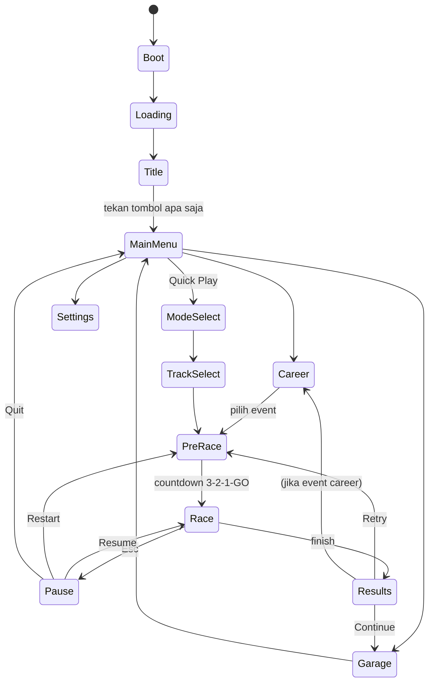

# VELOX — Game Balap Mobil 3D di Browser
### Dokumen Spesifikasi untuk Coding Agent

> **Untuk agent:** Dokumen ini adalah sumber kebenaran (single source of truth). Baca seluruhnya sebelum mulai. Kerjakan **per milestone** (lihat §17), jalankan dan verifikasi tiap milestone sebelum lanjut. Kalau ada hal yang tidak dijelaskan di sini, ambil keputusan yang paling masuk akal, catat di `DECISIONS.md`, lalu lanjut. "VELOX" adalah working title, boleh diganti.

---

## 0. Ringkasan

VELOX adalah game balap mobil **3D arcade** yang jalan di browser (HTML + WebGL). Fokus utama:

1. **Feel menyetir yang enak** — responsif, bisa drift, ada nitro, terasa cepat.
2. **Grafis yang bagus** — PBR, cat mobil mengkilap dengan refleksi, lampu neon, bloom, asap ban, skid mark.
3. **Alur game lengkap** — Loading → Title → Main Menu → Garasi → Pilih Mode/Track → Balapan → Hasil → kembali ke Garasi dengan reward.
4. **Progresi** — uang (credits), XP/level, unlock mobil, upgrade performa, kustomisasi visual, career mode.

Gaya: arcade (mirip semangat Need for Speed / Forza Horizon versi ringan), **bukan** simulasi.

---

## 1. Prinsip Wajib

- **Feel first.** Milestone fisika mobil (M1) harus terasa enak dulu sebelum polish grafis. Semua angka tuning ada di file data, bukan hard-coded.
- **Target 60 FPS** di laptop kelas menengah (iGPU) pada preset Medium. Selalu ada FPS counter (toggle F3).
- **Tidak boleh pakai merek/logo/desain mobil asli** (Ferrari, Toyota, dll.) maupun aset berhak cipta. Semua mobil desain orisinal. Aset pihak ketiga hanya lisensi **CC0/CC-BY**, catat di `CREDITS.md`.
- **Tidak boleh macet karena tool.** Kalau Blender tidak tersedia, pakai fallback (§6.6). Game harus tetap bisa dimainkan.
- **Data-driven.** Mobil, track, event career, upgrade, kosmetik semuanya didefinisikan di `src/data/*.ts`.
- **Verifikasi visual.** Setelah setiap perubahan visual, jalankan dev server dan ambil screenshot (kalau agent punya akses browser) untuk cek hasil.

---

## 2. Tech Stack

| Bagian | Pilihan | Alasan |
|---|---|---|
| Bahasa | **TypeScript** | Struktur jelas untuk project besar |
| Build | **Vite** | Dev server cepat, build statis |
| Render 3D | **Three.js** (WebGLRenderer, WebGL2) | Ekosistem terbesar, addons lengkap |
| Fisika | **Rapier** (`@dimforge/rapier3d-compat`) | Cepat (WASM), punya `DynamicRayCastVehicleController` |
| Post-processing | **`postprocessing`** (pmndrs) + **N8AO** | Bloom, SMAA, AO, vignette yang efisien |
| Aset 3D | **glTF/GLB** | Format standar web |
| Optimasi aset | **gltf-transform** CLI | Meshopt/Draco + kompresi tekstur (WebP/KTX2) |
| Audio | **Web Audio API** (opsional Howler.js untuk musik) | Engine sound dinamis berbasis RPM |
| UI | HTML/CSS overlay di atas canvas (vanilla TS) | Ringan, mudah di-styling |
| Save | `localStorage` (dengan versioning schema) | Tanpa backend |

Gunakan versi stabil terbaru tiap library saat setup; cek API terbaru di dokumentasi resmi (terutama Rapier vehicle controller dan Three.js addons) karena API bisa berubah antar versi.

**Opsional (stretch):** render path `WebGPURenderer` Three.js sebagai preset "Ultra" bila browser mendukung — jangan jadi dependensi utama.

---

## 3. Struktur Folder

```
velox/
├─ index.html
├─ package.json
├─ vite.config.ts
├─ tsconfig.json
├─ CREDITS.md
├─ DECISIONS.md
├─ public/
│  └─ assets/
│     ├─ cars/        # car_<id>.glb
│     ├─ props/       # props_<set>.glb (gedung, pohon, lampu jalan, barrier)
│     ├─ hdri/        # environment .hdr / .exr (1k–2k)
│     ├─ textures/    # asphalt, concrete, sand, decals, skidmark, smoke
│     ├─ audio/       # sfx + musik
│     └─ ui/          # icon, font
├─ tools/
│  ├─ blender/        # skrip bpy untuk generate aset (headless)
│  │  ├─ common.py
│  │  ├─ generate_car.py
│  │  ├─ generate_wheels.py
│  │  ├─ generate_props.py
│  │  └─ build_all.py
│  └─ scripts/        # optimize-assets.mjs, dll.
└─ src/
   ├─ main.ts
   ├─ core/      Game.ts, StateMachine.ts, Loop.ts, Input.ts, EventBus.ts,
   │             Save.ts, Settings.ts, AssetLoader.ts
   ├─ render/    Renderer.ts, PostFX.ts, Environment.ts, Materials.ts,
   │             QualityPresets.ts, CameraRig.ts
   ├─ physics/   PhysicsWorld.ts, VehicleController.ts, CarTuning.ts
   ├─ game/      Car.ts, CarFactory.ts, Track.ts, TrackBuilder.ts,
   │             RaceManager.ts, Checkpoints.ts, AIDriver.ts, Ghost.ts,
   │             Nitro.ts, Scoring.ts, Rewards.ts
   ├─ fx/        TireSmoke.ts, Skidmarks.ts, Sparks.ts, NitroFlame.ts,
   │             SpeedLines.ts, Weather.ts
   ├─ audio/     AudioManager.ts, EngineSound.ts, Music.ts, Sfx.ts
   ├─ ui/
   │  ├─ screens/  Loading, Title, MainMenu, Garage, ModeSelect, TrackSelect,
   │  │            PreRace, Pause, Results, Career, Settings, PhotoMode
   │  ├─ hud/      Speedometer, Minimap, RaceInfo, DriftMeter, Popups, Countdown
   │  └─ styles/
   └─ data/      cars.ts, tracks.ts, careerEvents.ts, upgrades.ts,
                 cosmetics.ts, aiProfiles.ts
```

---

## 4. Alur Game (State Machine)



**Detail tiap layar:**

- **Loading:** progress bar asli (dari `AssetLoader`), tips gameplay bergantian, logo animasi. Muat aset inti dulu (menu + mobil yang dimiliki); track di-load saat PreRace (lazy).
- **Title:** scene 3D mobil di jalan malam berkabut, kamera orbit pelan, logo besar, teks "Press any key / Tap to start" berkedip.
- **Main Menu:** latar 3D (mobil pemain di garasi/showroom), menu kiri: *Career, Quick Race, Time Trial, Free Roam, Garage, Settings*. Header: level, XP bar, credits.
- **Garage:** lihat §8.
- **Mode Select / Track Select:** kartu dengan preview (thumbnail render), info panjang track, jumlah lap, cuaca, waktu (siang/sunset/malam), best time pemain.
- **PreRace:** kamera sinematik mengitari grid start, tampilkan lawan + nama, lalu countdown dengan lampu start.
- **Race:** HUD (§11).
- **Pause:** blur latar, Resume / Restart / Settings / Quit.
- **Results:** posisi, waktu tiap lap, best lap, breakdown reward (posisi + drift + near miss + clean race bonus), XP bar naik beranimasi, notifikasi unlock baru.
- **Settings:** grafik (preset + toggle individual), audio (master/music/sfx/engine), kontrol (rebind keyboard, sensitivitas, assist), kamera default, satuan km/h atau mph.

Semua transisi antar layar pakai animasi (fade/slide 200–400 ms). Navigasi menu harus bisa pakai mouse, keyboard (panah + Enter + Esc), dan gamepad.

---

## 5. Daftar Mobil (8 mobil, desain orisinal)

Setiap mobil punya stat 1–10 (untuk UI) dan parameter tuning fisika riil di `cars.ts`.

| ID | Nama | Arketipe | Drive | Top | Accel | Handling | Drift | Harga | Unlock |
|---|---|---|---|---|---|---|---|---|---|
| `kestrel` | Kestrel GT | Hot hatch starter | FWD | 5 | 5 | 7 | 4 | gratis | awal |
| `vanta` | Vanta R | Coupe JDM, raja drift | RWD | 6 | 6 | 7 | 9 | 18.000 | Lv 2 |
| `brutus` | Brutus 69 | Muscle car klasik | RWD | 7 | 8 | 4 | 7 | 25.000 | Lv 3 |
| `ronin` | Ronin S | Rally hatch | AWD | 6 | 7 | 8 | 6 | 30.000 | Lv 4 |
| `solace` | Solace EV | Sedan listrik | AWD | 7 | 9 | 6 | 3 | 42.000 | Lv 6 |
| `dunerat` | Dune Rat | Buggy offroad | AWD | 5 | 7 | 6 | 8 | 35.000 | Lv 5 |
| `aurora` | Aurora V12 | Supercar wedge | RWD | 9 | 8 | 8 | 6 | 90.000 | Lv 9 |
| `phantom` | Phantom X | Hypercar | AWD | 10 | 10 | 9 | 5 | 200.000 | Lv 14 / juara Career Tier 4 |

**Ciri visual tiap mobil (untuk generator aset):**
- *Kestrel GT:* hatchback 3 pintu, kompak, spoiler atap kecil.
- *Vanta R:* coupe rendah, lampu pop-up/strip tipis, fender lebar.
- *Brutus 69:* panjang, kap mesin besar dengan scoop, garis double stripe.
- *Ronin S:* hatch tinggi, lampu kabut di bumper, mud flap.
- *Solace EV:* sedan mulus, tanpa grill, light bar penuh depan & belakang.
- *Dune Rat:* rangka tubular terbuka, ban besar, lampu atap.
- *Aurora V12:* bentuk baji tajam, intake samping besar, sayap belakang.
- *Phantom X:* kanopi gelembung, fin vertikal, lampu LED garis.

**Parameter tuning per mobil (contoh field):**
```ts
interface CarTuning {
  massKg: number;
  enginePowerKw: number;          // gaya dorong maksimum
  torqueCurve: [rpm: number, factor: number][];
  gearRatios: number[]; finalDrive: number;
  idleRpm: number; redlineRpm: number; shiftUpRpm: number;
  maxSteerDeg: number; steerSpeed: number; speedSensitiveSteer: number;
  brakeForce: number; handbrakeForce: number;
  frictionSlip: { front: number; rear: number };
  driftRearGripFactor: number;    // grip belakang saat handbrake/drift
  suspension: { restLength: number; stiffness: number; damping: number; compression: number; travel: number };
  antiRoll: number; downforce: number; centerOfMassOffsetY: number;
  drivetrain: 'FWD' | 'RWD' | 'AWD'; awdFrontSplit?: number;
  nitroForce: number; nitroCapacity: number;
  engineSoundProfile: 'i4' | 'v8' | 'v12' | 'ev' | 'boxer';
}
```

---

## 6. Pipeline Aset (Blender & Rekomendasi)

### 6.1 Rekomendasi utama
**Blender dijalankan headless lewat Python (`bpy`)** adalah pilihan terbaik untuk coding agent: bisa membuat model secara prosedural lewat skrip, deterministik, bisa di-rerun, dan ekspor langsung ke GLB.

```
blender -b -P tools/blender/build_all.py -- --out public/assets
```

Jika agent punya akses ke Blender melalui MCP/GUI, manfaatkan untuk iterasi visual (screenshot viewport), tapi **hasil akhir tetap harus bisa direproduksi dari skrip**.

### 6.2 Sumber pendukung (gratis, CC0)
- **Poly Haven** — HDRI (langit malam kota, sunset, gurun) dan tekstur PBR (aspal, beton, pasir).
- **Kenney** (Car Kit, City Kit) & **Quaternius** — props low-poly sebagai fallback/pelengkap.
- **ambientCG** — tekstur PBR tambahan.

### 6.3 Opsional: generator 3D berbasis AI
Untuk mobil "hero" yang lebih detail, generator AI (mis. Meshy, Tripo, Hyper3D Rodin) bisa menghasilkan model lebih kaya, **tapi** butuh akun/API key dari pemilik project dan biasanya perlu cleanup (retopo, pisah roda, rename material). **Jangan gunakan tanpa API key yang diberikan pemilik project.** Jika dipakai, hasil tetap harus mengikuti konvensi §6.4.

### 6.4 Konvensi model mobil (WAJIB)
- Satuan: **1 unit = 1 meter**. Panjang mobil 3.8–4.8 m, lebar ~1.9 m.
- Orientasi: di Blender depan mobil menghadap **−Y**, atas **+Z** (setelah ekspor glTF → Three.js: depan **+Z**, atas **+Y**).
- Origin root di tengah bawah mobil (di atas tanah).
- Hierarki & nama node:
  ```
  Car_<id>
  ├─ Body            (material "Paint" — bisa diganti warna)
  ├─ Trim            (material "Trim" — plastik hitam/karbon)
  ├─ Chrome          (material "Chrome")
  ├─ Glass           (material "Glass")
  ├─ Interior        (sederhana: kursi, setir, dashboard)
  ├─ Light_Head      (material "LightHead" — emissive)
  ├─ Light_Tail      (material "LightTail" — emissive, makin terang saat rem)
  ├─ Light_Underglow_Socket (empty)
  ├─ Spoiler_0..N    (varian spoiler, default hanya 0 yang visible)
  ├─ Socket_Exhaust_L / Socket_Exhaust_R  (empty — posisi api nitro)
  ├─ Socket_Camera_Hood / Socket_Camera_Bumper (empty)
  └─ Wheel_FL / Wheel_FR / Wheel_RL / Wheel_RR  (origin di pusat hub)
     └─ Rim, Tire, Caliper (material "Caliper" — bisa diganti warna)
  ```
- Roda juga diekspor terpisah sebagai `wheels.glb` berisi beberapa desain velg (`Rim_01..06`) untuk kustomisasi.
- Poligon: LOD0 ≤ 60k tris (mobil pemain), LOD1 ≤ 20k (AI dekat), LOD2 ≤ 5k (AI jauh). Pakai modifier Bevel + Weighted Normal agar panel terlihat halus dan mengkilap.
- Tekstur maksimal 2K; boleh bake AO ke tekstur untuk body.

### 6.5 Teknik membuat mobil prosedural di Blender (arahan)
1. Buat profil samping & atas dari kurva Bezier sesuai arketipe → loft/extrude jadi body dasar.
2. Potong wheel arch dengan Boolean (silinder), tambahkan fender flare.
3. Pisahkan panel kaca (greenhouse) jadi objek `Glass`.
4. Tambah detail: grill/intake (inset + extrude), lampu (strip emissive), garis pintu (edge crease atau knife + bevel tipis), spion, gagang pintu, knalpot.
5. Bevel + Subdivision ringan + Weighted Normal → Apply.
6. Material dasar Principled BSDF (glTF exporter mempertahankan base color, metallic, roughness, emissive; clearcoat diatur ulang di Three.js).
7. Ekspor GLB: `apply modifiers`, `+Y up`, tanpa kamera/lampu Blender.

### 6.6 Fallback (jika Blender tidak tersedia)
1. Bangun mobil secara prosedural di Three.js (`CarFactory.buildProcedural(id)`) dengan **nama node yang sama** seperti §6.4, sehingga sisa kode tidak berubah.
2. Atau gunakan Kenney Car Kit (CC0) sebagai placeholder sementara.
Catat fallback yang dipakai di `DECISIONS.md`.

### 6.7 Optimasi
```
gltf-transform optimize in.glb out.glb --compress meshopt --texture-compress webp
```
(Gunakan KTX2 jika `toktx` tersedia.) Target total download awal < 30 MB; track di-load lazy.

### 6.8 Thumbnail
Thumbnail mobil & track dirender **di dalam engine** (offscreen render Three.js dengan pencahayaan studio) agar konsisten dengan tampilan game, lalu di-cache sebagai data URL.

---

## 7. Fisika & Kontrol Mobil

### 7.1 Model
- Rapier `DynamicRayCastVehicleController` (4 raycast wheel). Jika API tidak memadai, implementasi raycast-vehicle sendiri di atas rigid body Rapier.
- Fixed timestep 60 Hz untuk fisika, render diinterpolasi.
- Gearbox otomatis (default) dengan simulasi RPM — penting untuk suara mesin dan "rasa" akselerasi. Opsi manual (Q/E) di Settings.

### 7.2 Fitur arcade
- **Drift:** handbrake menurunkan grip belakang (`driftRearGripFactor`); saat sudut slip > ~15° dan kecepatan > 40 km/h → status drifting. Drift assist (opsi) membantu counter-steer otomatis.
- **Nitro:** dorongan maju + efek visual (FOV naik, motion blur radial, api knalpot, chromatic aberration ringan). Terisi dari: drift, near miss, slipstream, lompatan (airtime), dan lewat checkpoint dengan bersih.
- **Slipstream:** di belakang lawan dalam kerucut ±10°, < 15 m → hambatan berkurang + nitro terisi.
- **Downforce** naik sesuai kecepatan, **anti-roll** mencegah terguling.
- **Auto-reset:** jika terbalik > 2 detik atau keluar track, respawn di checkpoint terakhir (tekan R untuk manual).
- **Assist** (Settings): steering assist, traction control, ABS, drift assist.

### 7.3 Input
| Aksi | Keyboard | Gamepad | Touch (mobile) |
|---|---|---|---|
| Gas | W / ↑ | RT | tombol kanan |
| Rem/Mundur | S / ↓ | LT | tombol kanan |
| Belok | A D / ← → | Stik kiri | tombol kiri / tilt (opsi) |
| Handbrake | Space | A / Cross | tombol |
| Nitro | Shift | B / Circle | tombol |
| Ganti kamera | C | Y / Triangle | tombol kecil |
| Lihat belakang | X (tahan) | RB | — |
| Reset | R | Select/Back | tombol kecil |
| Pause | Esc / P | Start | ikon pause |

Input analog dihaluskan (smoothing) untuk keyboard; dukung rebind keyboard.

### 7.4 Kamera
- **Chase** (default): spring-damper, sedikit terlambat saat belok, FOV dinamis sesuai kecepatan, camera shake halus saat kecepatan tinggi/benturan/landing.
- **Chase jauh**, **Hood**, **Bumper**.
- **Sinematik** untuk PreRace, replay, dan finish.
- Kamera tidak boleh menembus dinding (raycast mundur).

---

## 8. Garasi

Garasi adalah showroom 3D: lantai beton mengkilap (reflection), lampu strip di langit-langit, mobil di atas turntable yang berputar pelan. Mouse drag / swipe untuk orbit, scroll/pinch untuk zoom.

**Tab:**
1. **Mobil Saya** — pilih mobil aktif, lihat stat (bar 1–10 + angka riil: top speed, 0–100 km/h, berat, tenaga).
2. **Dealer** — beli mobil (yang terkunci ditampilkan siluet + syarat unlock).
3. **Performa (Upgrade)** — 5 kategori, masing-masing level 0–5:
   - Engine (tenaga), Turbo (akselerasi), Tires (grip), Suspension (handling), Nitro (kapasitas & kekuatan), Weight Reduction.
   - Tampilkan **preview stat** (bar hijau = kenaikan) sebelum beli.
   - Hitung **Performance Index (PI)** untuk tiap mobil → dipakai pembatasan kelas di career (D / C / B / A / S).
4. **Visual (Kustomisasi)** — perubahan langsung terlihat di model:
   - Cat: warna (palette + color picker), finishing *Gloss / Metallic / Matte / Pearl / Chrome*.
   - Velg: 6 desain + warna velg.
   - Warna kaliper rem.
   - Spoiler: 3–4 varian.
   - Underglow: warna & on/off (terlihat jelas di track malam).
   - Kaca: tint gelap/terang.
   - Decal/livery sederhana: stripe, nomor balap, pola (dibuat prosedural via canvas texture).
5. **Tuning (opsional, unlock Lv 5)** — slider: ketinggian suspensi, kekakuan, bias rem, rasio final drive, sudut sayap (downforce vs top speed).

Kamera garasi bergerak ke sudut yang relevan saat membuka tab (velg → close-up roda, spoiler → belakang).

---

## 9. Mode Permainan

| Mode | Deskripsi | Fase |
|---|---|---|
| **Quick Race** | Circuit vs 5–7 AI, pilih track/lap/kesulitan | M3–M4 |
| **Time Trial** | Sendiri, kejar best time, ada **ghost** dari lap terbaik | M3 |
| **Career** | 4 tier × 5 event, pembatasan kelas PI, hadiah besar | M8 |
| **Drift Attack** | Skor drift dalam batas waktu, multiplier combo | M8 |
| **Checkpoint Rush** | Lewati checkpoint sebelum timer habis, tiap checkpoint tambah waktu | M8 |
| **Elimination** | Posisi terakhir tereliminasi setiap akhir lap | M8 |
| **Free Roam** | Jelajah map bebas: koleksi token, papan lompat, speed trap, kamera kecepatan | M10 |

**Career (contoh struktur):**
- *Tier 1 — Street Rookie* (kelas D/C): 3 race, 1 drift, 1 time trial.
- *Tier 2 — Night Circuit* (kelas C/B).
- *Tier 3 — Coastal Cup* (kelas B/A).
- *Tier 4 — Apex Championship* (kelas A/S): finale melawan "boss" AI dengan nama & mobil khusus.
Tiap event memberi 1–3 bintang (podium / target waktu / clean race). Bintang membuka tier berikutnya.

---

## 10. Track & Lingkungan

Track dibangun **di dalam engine** dari spline (`CatmullRomCurve3`) oleh `TrackBuilder`:
- Mesh jalan (ekstrusi profil penampang dengan banking/kemiringan per titik), marka jalan, kerb merah-putih di tikungan, barrier, pagar, collider fisika otomatis dari mesh yang sama.
- Props diletakkan otomatis di sepanjang spline (dengan seed) memakai **InstancedMesh**: lampu jalan, pohon, gedung, batu, papan reklame neon (teks fiktif).
- Data checkpoint, grid start, dan racing line (untuk AI & minimap) diambil dari spline.

**Lingkungan (3 utama + 1 bonus):**
1. **Neon District** — kota malam, jalan basah (reflection), gedung dengan jendela emissive, papan neon, kabut tipis. Paling "wow" secara grafis — kerjakan duluan.
2. **Coastal Sunset** — jalan tepi tebing pantai, HDRI sunset, laut (shader air sederhana dengan gelombang), pohon palem.
3. **Canyon Run** — gurun/ngarai, debu di belakang mobil, jalan sebagian tanah (grip lebih rendah), lompatan.
4. *(Bonus)* **Snow Pass** — pegunungan bersalju, salju turun, grip rendah.

Tiap lingkungan punya 2 layout + versi reverse. Variasi waktu: siang / sunset / malam; cuaca: cerah / hujan (hujan = partikel, jalan basah lebih mengkilap, grip sedikit turun, wiper tidak perlu).

---

## 11. HUD Balapan

- **Speedometer** kanan bawah: arc analog dengan jarum + angka digital besar + gear + bar RPM (merah dekat redline).
- **Nitro bar** di bawah speedometer, menyala saat penuh.
- **Kiri atas:** posisi (mis. **3**/8), lap 2/3, waktu lap sekarang, best lap, selisih vs best (hijau/merah).
- **Minimap** kiri bawah: garis track dari spline, titik pemain & lawan, berputar mengikuti arah pemain.
- **Popup skor** tengah: "DRIFT +1.250 x3", "NEAR MISS +300", "SLIPSTREAM", "AIRTIME 1.2s", "CLEAN SECTION".
- Indikator **WRONG WAY**, papan countdown 3-2-1-GO, banner "FINAL LAP", efek "FINISH" dengan slow-motion singkat.
- Semua elemen punya animasi masuk/keluar; skala UI menyesuaikan resolusi dan mobile.

---

## 12. AI Lawan

- Mengikuti **racing line** (dari spline + offset per AI) dengan lookahead tergantung kecepatan; rem sebelum tikungan berdasarkan kurvatur.
- Variasi per AI (`aiProfiles.ts`): agresivitas, kemampuan, kecenderungan pakai nitro, kesalahan acak kecil (understeer, telat rem).
- Bisa menyalip (pindah lane offset), menghindari tabrakan dengan raycast depan.
- **Rubber-banding ringan** (bisa dimatikan di Settings): AI yang terlalu jauh di depan sedikit melambat, yang jauh di belakang sedikit lebih cepat — maksimal ±8%.
- Tingkat kesulitan: Easy / Normal / Hard / Legend.
- AI memakai LOD1/LOD2 dan fisika yang sama dengan pemain (agar adil).

---

## 13. Grafis (Target Visual)

Target: terlihat seperti game indie modern, mengkilap dan sinematik.

**Renderer:**
- `toneMapping = ACESFilmic` (atau AgX), `outputColorSpace = SRGB`, exposure dapat diatur per lingkungan.
- Environment map dari HDRI via PMREM untuk refleksi semua material PBR.
- Shadow: directional light dengan shadow map yang **mengikuti mobil pemain** (atau Cascaded Shadow Maps di preset High+), PCF soft.

**Material mobil:**
- `MeshPhysicalMaterial` untuk cat: `clearcoat = 1`, `clearcoatRoughness` rendah, metalness/roughness sesuai finishing; Pearl = `iridescence` ringan; Metallic = normal map flake halus.
- Kaca: transparan gelap dengan refleksi env (hindari `transmission` di preset rendah).
- Lampu depan: emissive + spotlight (hanya untuk mobil pemain di preset tinggi) + **cone volumetrik palsu** (mesh kerucut additive) saat malam.
- Lampu belakang lebih terang saat rem; lampu mundur.

**Efek:**
- Asap ban (partikel billboard instanced, soft) saat drift/burnout.
- Skid mark (ribbon mesh decal yang memudar).
- Percikan (sparks) saat menggesek dinding.
- Api nitro dari `Socket_Exhaust_*`.
- Speed lines di tepi layar saat nitro/kecepatan sangat tinggi.
- Debu (Canyon), cipratan air & hujan (Neon/hujan), salju.
- Jalan basah: roughness rendah + refleksi (screen-space reflection di Ultra, env map di preset lain).

**Post-processing (pmndrs `postprocessing`):**
- Bloom (threshold tinggi — supaya neon & lampu yang glow, bukan seluruh layar)
- SMAA
- N8AO (ambient occlusion) di Medium+
- Vignette, color grading per lingkungan (LUT)
- Motion blur radial / chromatic aberration ringan hanya saat nitro
- Depth of field hanya di garasi, menu, dan photo mode

**Preset kualitas** (auto-detect saat pertama main berdasarkan benchmark singkat, bisa diubah):

| | Low | Medium | High | Ultra |
|---|---|---|---|---|
| Resolusi render | 0.7× | 1.0× | 1.0× | 1.0× (DPR penuh) |
| Shadow | off/blob | 1024 | 2048 CSM | 4096 CSM |
| AO | off | N8AO half-res | N8AO | N8AO full |
| Bloom | ringan | ya | ya | ya |
| Partikel | 25% | 60% | 100% | 100% |
| Refleksi jalan | env | env | env | SSR |
| Jarak gambar props | dekat | sedang | jauh | jauh |

**Budget performa:** < 300 draw call per frame (pakai instancing & merge geometry statis), tekstur ≤ 2K, target 60 FPS Medium di iGPU.

---

## 14. Audio

- **Engine sound dinamis** per `engineSoundProfile`: pitch & volume mengikuti RPM dan throttle, layering on-load/off-load, suara turbo "psst" saat lepas gas, pop/backfire saat downshift (mobil tertentu), dengung khas untuk EV. Bisa disintesis dengan Web Audio (oscillator + filter + distortion) atau sampel loop CC0 yang di-pitch-shift.
- Suara gear shift, ban berdecit (volume ~ slip), benturan (intensitas ~ impuls), angin (~ kecepatan), nitro whoosh, hujan.
- Suara spasial (PannerNode) untuk mobil AI.
- **Musik:** menu (chill synthwave), balapan (energi tinggi), intensitas naik di final lap. Gunakan musik CC0/CC-BY atau generate placeholder; catat lisensi.
- UI SFX: hover, klik, beli, unlock, level up.

---

## 15. Progresi & Ekonomi

- **Credits** dari: posisi finish (1st: 5.000 × multiplier tier), drift score, near miss, clean race, bintang career.
- **XP** dari semua aktivitas; naik level membuka mobil, mode, dan item kosmetik.
- **Harga upgrade** naik per level (mis. 1.000 / 2.500 / 5.000 / 9.000 / 15.000 × faktor kelas mobil).
- **Daily Challenge** (opsional M10): satu event acak berdasarkan tanggal (seed), hadiah bonus.
- Balancing: pemain baru bisa membeli mobil kedua setelah ±5–7 race.

**Save schema (`localStorage`, key `velox_save_v1`):**
```json
{
  "version": 1,
  "profile": { "name": "Player", "level": 1, "xp": 0, "credits": 5000 },
  "garage": {
    "activeCar": "kestrel",
    "owned": {
      "kestrel": {
        "upgrades": { "engine": 0, "turbo": 0, "tires": 0, "suspension": 0, "nitro": 0, "weight": 0 },
        "visual": { "paint": "#d7263d", "finish": "metallic", "rim": "Rim_01", "rimColor": "#222222",
                    "caliper": "#ffcc00", "spoiler": 0, "underglow": null, "tint": 0.3, "livery": null },
        "tuning": {}
      }
    }
  },
  "career": { "stars": {}, "unlockedTier": 1 },
  "records": { "neon_a": { "bestLap": null, "ghost": null } },
  "settings": { "quality": "auto", "units": "kmh", "assists": {}, "audio": {}, "bindings": {} }
}
```
Sertakan migrasi versi save dan tombol "Reset Progress" (dengan konfirmasi).

---

## 16. Fitur Tambahan Supaya Lebih Seru

Kerjakan setelah inti selesai (M10), urutkan berdasarkan dampak:
1. **Photo Mode** — pause, kamera bebas, filter, DOF, sembunyikan HUD, simpan PNG.
2. **Replay** — rekam transform semua mobil per frame (atau tiap 2 frame), putar ulang dengan kamera sinematik otomatis (kamera pinggir jalan, helikopter, onboard).
3. **Ghost** di Time Trial (sudah di M3) + ekspor/impor ghost sebagai kode teks untuk tantang teman.
4. **Near miss lalu lintas** di Free Roam (mobil sipil sederhana).
5. **Kerusakan visual ringan** — goresan (decal) dan kap/bumper sedikit penyok (vertex offset sederhana), tidak memengaruhi performa mobil.
6. **Momen sinematik** — slow-motion singkat saat lompatan besar atau menyalip di garis finish.
7. **Achievement** — "Drift 10.000 poin dalam satu drift", "Menang tanpa menabrak", dll.
8. **Siklus siang-malam** di Free Roam.

---

## 17. Milestone & Kriteria Selesai

Kerjakan berurutan. Setiap milestone: build lolos tanpa error TypeScript, game bisa dijalankan, commit dengan pesan jelas.

**M0 — Skeleton**
- Vite + TS + Three.js + Rapier ter-setup, game loop fixed-timestep, state machine, AssetLoader dengan progress.
- Semua layar ada (boleh polos) dan bisa dinavigasi sesuai §4.
- ✅ Bisa klik dari Title → Menu → Garage → Race (scene kosong) → Results → kembali.

**M1 — Driving Prototype (paling penting)**
- Satu mobil (boleh kotak) di bidang datar dengan beberapa rintangan dan ramp, fisika raycast vehicle, gearbox, drift, nitro, kamera chase, reset.
- Panel debug (lil-gui) untuk tuning live.
- ✅ Mobil terasa responsif, bisa drift terkontrol, tidak gampang terguling, 60 FPS.

**M2 — Pipeline Aset**
- Skrip Blender headless menghasilkan minimal 3 mobil + set velg sesuai konvensi §6.4 (atau fallback §6.6).
- `CarFactory` memuat GLB, memasang roda ke physics, material cat bisa diganti.
- ✅ Mobil tampil benar (orientasi, skala, roda berputar & berbelok), material PBR terlihat mengkilap.

**M3 — Track & Race Loop**
- `TrackBuilder` dari spline, track Neon District layout A, checkpoint, lap, countdown, deteksi finish, WRONG WAY, Time Trial + ghost.
- ✅ Bisa menyelesaikan 3 lap, waktu tercatat, best lap tersimpan.

**M4 — AI**
- 5–7 AI dengan profil berbeda, posisi real-time, slipstream.
- ✅ AI menyelesaikan balapan tanpa nyangkut; balapan terasa kompetitif di Normal.

**M5 — Garasi, Ekonomi, Save**
- Showroom 3D, dealer, upgrade, kustomisasi visual live, PI, reward, XP/level, save/load.
- ✅ Reward dari race bisa dipakai beli upgrade; perubahan bertahan setelah refresh.

**M6 — Polish Grafis**
- HDRI, post-processing, semua efek §13, preset kualitas + auto-detect, lingkungan Coastal & Canyon.
- ✅ Screenshot Neon District malam terlihat "wow": refleksi jalan basah, neon bloom, asap ban; Medium tetap 60 FPS.

**M7 — Audio**
- Engine sound dinamis, SFX, musik, mixer di Settings.
- ✅ Suara mesin berubah halus sesuai RPM & perpindahan gigi.

**M8 — Career & Mode Tambahan**
- Career 4 tier, Drift Attack, Checkpoint Rush, Elimination, sistem bintang.
- ✅ Career bisa dimainkan dari awal sampai finale.

**M9 — Mobile & QA**
- Kontrol sentuh, layout responsif, preset Low untuk mobile, pause otomatis saat tab tidak aktif, penanganan WebGL context lost.
- ✅ Bisa dimainkan di Chrome Android kelas menengah ≥ 30 FPS.

**M10 — Fitur Ekstra**
- Pilih dari §16 (minimal Photo Mode, Replay, Free Roam).

---

## 18. Checklist QA Akhir

- [ ] Tidak ada error/warning di console saat bermain normal.
- [ ] Alur lengkap bisa dijalankan dengan keyboard saja, gamepad saja, dan touch saja.
- [ ] Semua mobil bisa dibeli, di-upgrade, dikustomisasi, dan dikendarai di semua track.
- [ ] Save bertahan setelah refresh; save rusak tidak membuat game crash (fallback ke default).
- [ ] FPS sesuai target di tiap preset; tidak ada memory leak saat pindah track berulang (dispose geometry/material/texture).
- [ ] Tidak ada merek/logo asli; `CREDITS.md` lengkap untuk semua aset pihak ketiga.
- [ ] `npm run build` menghasilkan folder statis yang bisa di-host di mana saja (GitHub Pages / Netlify / Vercel).
- [ ] `README.md` berisi: cara install, menjalankan dev server, regenerate aset Blender, dan kontrol.

---

## 19. Catatan untuk Agent

- Jika ragu antara "lebih cantik" vs "lebih lancar", **pilih lancar** lalu tambahkan kecantikan lewat preset kualitas.
- Jangan memasukkan semua fitur sekaligus; fitur yang belum selesai disembunyikan di balik flag `FEATURES` di `src/data/features.ts`.
- Simpan semua angka balancing di `src/data/` agar mudah diubah tanpa menyentuh logika.
- Setelah tiap milestone, tulis ringkasan singkat di `PROGRESS.md`: apa yang selesai, apa yang tertunda, dan masalah yang diketahui.
